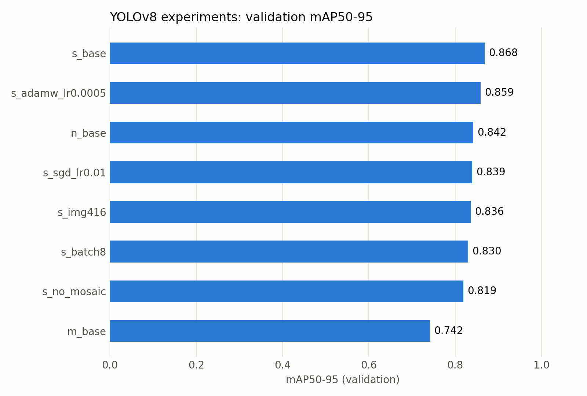
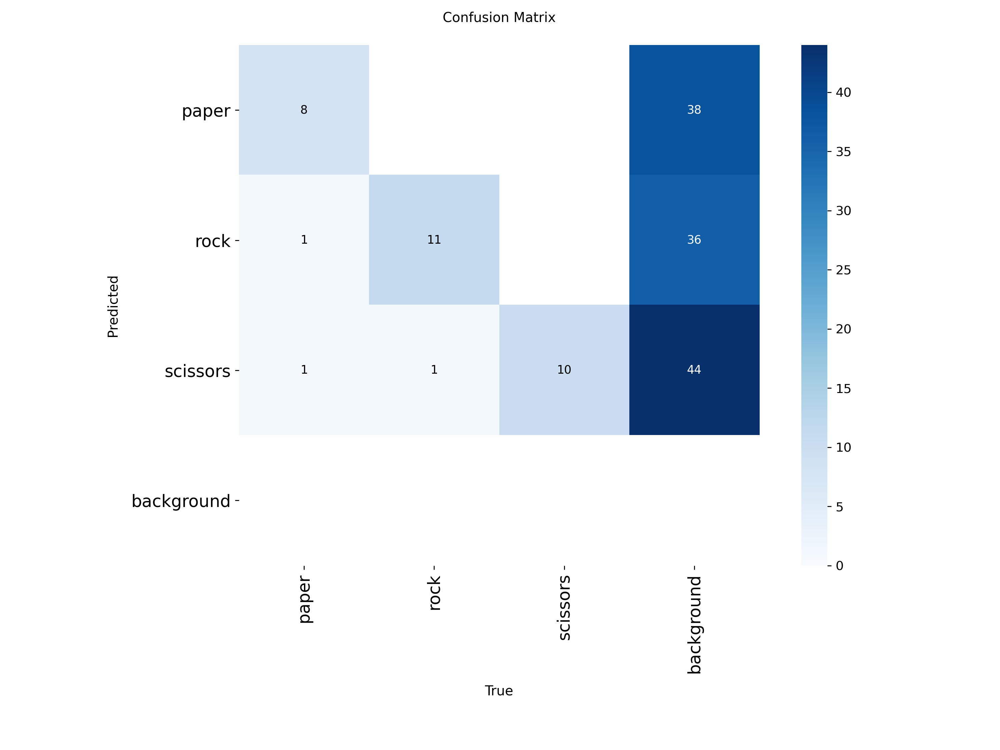
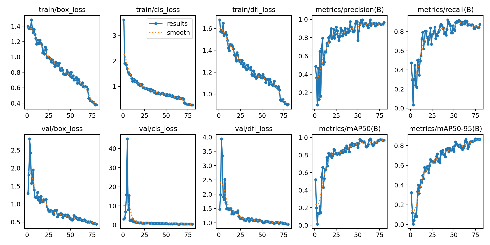

# 1. Training

**Owner:** Raghad

## What's in this folder

- [x] `train.ipynb`: the Colab training notebook, **with its outputs** (tables and charts), so others can see the results without re-running it.
- [x] `weights/best.pt`: the best model. Deployment and evaluation both use this file.
- [x] `comparison.csv` and `comparison.png`: the comparison of all experiments.
- [x] `confusion_matrix.png` and `results.png` of the best model.
- [x] This README.

The notebook asks for the Roboflow API key when it runs (`getpass`), so no key is saved in it.

## Dataset

- **Source:** Roboflow project `rock-paper-scissors-tgfhs`, **version 3**, exported in YOLOv8 format
- **Classes (3):** `paper`, `rock`, `scissors`
- **Background images:** photos of hands that are not doing any of the three gestures, plus some noisy photos. They are left unannotated, so the model learns not to put a box on them.

| Split | Images | Background images (no boxes) | Notes |
|---|---|---|---|
| Train | 288 | 27 | Includes the augmented copies |
| Valid | 27 | 2 | 32 labeled objects |
| Test | 13 | 0 | 17 labeled objects |

- **Preprocessing:** TODO: copy from the Roboflow version page (for example: Auto-Orient, Resize to 640×640)
- **Augmentation (train set only):** TODO: copy from the Roboflow version page (for example: horizontal flip, brightness ±15%, blur up to 1px, 3× output)

## Experiments

All experiments share the same base settings: `epochs=80`, `imgsz=640`, `batch=16`, `patience=20` (early stopping), `seed=0`, starting from COCO-pretrained weights. Each experiment changes **one** thing, so any difference can be traced to that change. With `optimizer="auto"`, YOLO picks the optimizer and learning rate itself.

Sorted by validation mAP50-95:

| Experiment | Model | What changed | Val Precision | Val Recall | Val mAP50 | Val mAP50-95 | Test mAP50 | Test mAP50-95 | Size (MB) | Inference (ms) |
|---|---|---|---|---|---|---|---|---|---|---|
| **`s_base`** | YOLOv8s | baseline | 0.952 | 0.852 | **0.973** | **0.868** | 0.882 | 0.826 | 22.5 | 9.7 |
| `s_adamw_lr0.0005` | YOLOv8s | AdamW, lr0 = 0.0005 | 0.931 | 0.882 | 0.951 | 0.859 | 0.946 | 0.888 | 22.5 | 9.7 |
| `n_base` | YOLOv8n | nano model | 0.901 | 0.909 | 0.946 | 0.842 | 0.929 | 0.896 | 6.5 | 5.2 |
| `s_sgd_lr0.01` | YOLOv8s | SGD, lr0 = 0.01 | 0.945 | 0.935 | 0.970 | 0.839 | 0.891 | 0.783 | 22.5 | 9.8 |
| `s_img416` | YOLOv8s | image size 416 | 0.948 | 0.832 | 0.946 | 0.836 | 0.948 | 0.901 | 22.5 | 6.9 |
| `s_batch8` | YOLOv8s | batch size 8 | 0.984 | 0.879 | 0.943 | 0.830 | 0.971 | 0.837 | 22.5 | 10.5 |
| `s_no_mosaic` | YOLOv8s | mosaic off | 0.953 | 0.899 | 0.925 | 0.819 | 0.934 | 0.784 | 22.5 | 10.3 |
| `m_base` | YOLOv8m | medium model | 0.954 | 0.873 | 0.951 | 0.742 | 0.841 | 0.737 | 52.0 | 24.2 |

The full table (with epochs run and training time) is in [`comparison.csv`](comparison.csv).



**What the experiments show:**
- **A bigger model is not better here.** YOLOv8m is the worst on both validation and test (0.742 / 0.737 mAP50-95). With this little data it has far more parameters than it needs, and it is also the slowest (24.2 ms per image).
- **The nano model is a strong option.** `n_base` scores close to the small models at less than a third of the size (6.5 MB) and the fastest inference (5.2 ms).
- **The hyperparameter changes made only small differences.** All YOLOv8s variants are between 0.819 and 0.868 val mAP50-95. With only 27 validation images, differences of a few points may be chance.
- **Validation and test rankings disagree.** For example, `s_img416` is 5th on validation but 1st on test. With 13 test images, a single detection changes the score noticeably.

## Best model

**`weights/best.pt` = experiment `s_base`** (YOLOv8s, default settings, 640×640, trained for the full 80 epochs).

**Why it was chosen:** it has the highest **validation** mAP50-95 (0.868) and validation mAP50 (0.973). The model is chosen on the validation set. The test set is only used for a final check, so it stays an unbiased estimate.

On the test set it scores mAP50 = 0.882 and mAP50-95 = 0.826. That is lower than some other experiments, but with 13 test images the ranking is not reliable.

**Per-class results (validation):**

| Class | Precision | Recall | mAP50 | mAP50-95 |
|---|---|---|---|---|
| paper | 0.964 | 0.800 | 0.977 | 0.812 |
| rock | 1.000 | 0.856 | 0.995 | 0.887 |
| scissors | 0.892 | 0.900 | 0.947 | 0.906 |

- **Rock** has perfect precision: when the model says "rock", it is always right.
- **Paper** has the lowest recall (0.80). In the confusion matrix, 2 of the 10 paper hands were predicted as rock or scissors.
- **Scissors** has the lowest precision (0.892). A paper hand and a rock hand were each labeled as scissors once.



**Training curves:** training and validation losses both keep falling until the end, so the model is **not overfitting**. Validation mAP50-95 is still slowly rising at epoch 80, so training for more epochs could improve it a little.



## Using the model

```python
from ultralytics import YOLO

model = YOLO("1_training/weights/best.pt")
results = model.predict("image.jpg", imgsz=640, conf=0.5)
results[0].show()
```

Use `imgsz=640`, the size the model was trained with.
