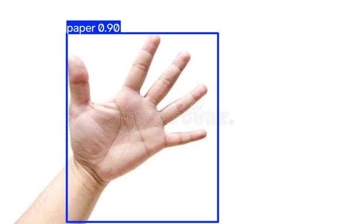
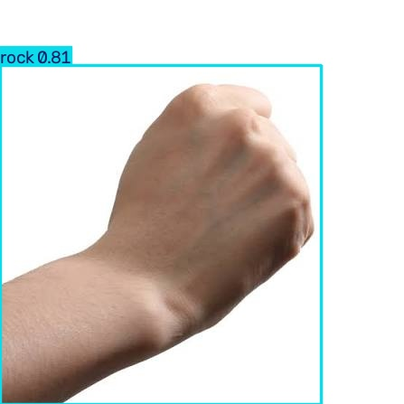
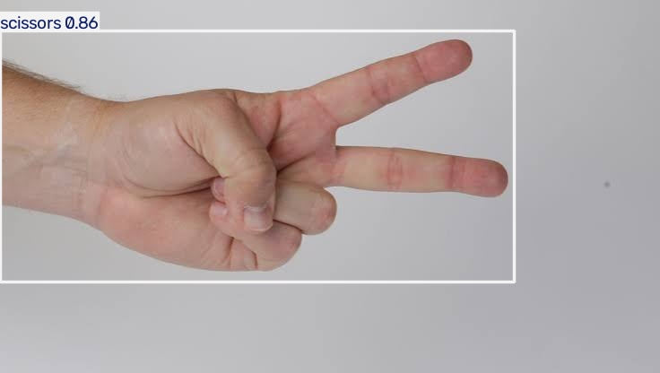
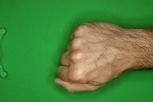
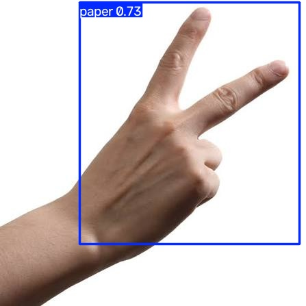
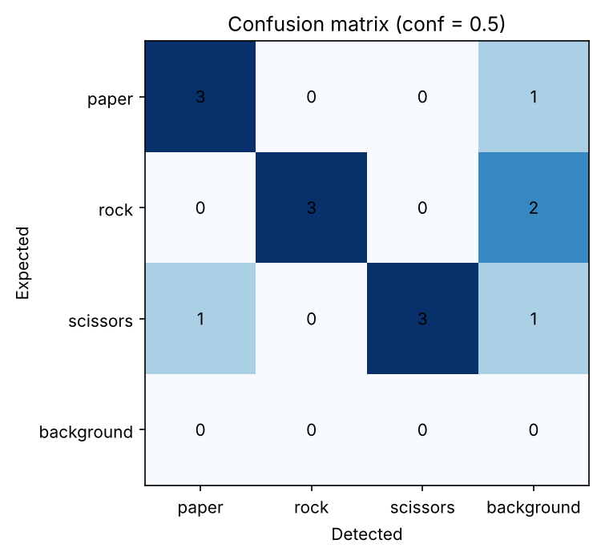

# 3. Testing and evaluation

**Owner:** Hassan

Uses the model from [`1_training/weights/best.pt`](../1_training/).

## What to upload here

- [ ] `new_images/`: 10 to 15 **new** photos that were never in the Roboflow dataset (different people, places and angles, some with two hands).
- [ ] `predictions/`: the same photos with the model's boxes drawn on them, and a table of what was detected.
- [ ] `confusion_matrix_conf05.png`: the confusion matrix at confidence 0.5, the threshold the app uses.
- [ ] This README, filled in below.

## Which gestures are detected well?
All three gestures are detected reliably when the photo is clear and the whole hand is visible.

- Paper is the strongest class. It was found from the back of the hand (09_paper_back-of-hand_white, 0.84) and from the palm side (10_paper_palm-up_white, 0.90). It was also found against a busy, colourful sticky-note wall (04_paper_stickynotes-wall, 0.85).
- Rock is detected well when the fist faces the camera or shows the back of the hand: 11_rock_back-of-hand_white (0.81) and 05_rock_stickynotes-wall (0.71).
- Scissors is detected well when the two fingers point sideways: 07_scissors_side-view_grey (0.86).
- Two hands: in 06_scissors+rock_two-hands_white both hands were found with the correct labels and separate boxes (scissors 0.84, rock 0.73).

*With examples from the new photos.*

| Paper | Rock | Scissors | Two hands |
|---|---|---|---|
|  |  |  |  |

Overall: **7 of 12 photos fully correct** and **9 of 14 hands correct**. There were no false alarms: the model never detected a hand that was not there.

## Which are missed or confused?

*With examples, and a likely reason for each mistake.*

- **01_rock_greenscreen, 02_paper_greenscreen, 03_scissors_greenscreen were missed completely.** Nothing was detected above 0.5; rock reached only 0.24.
  *Likely reason:* these photos are small (300×200) and blurry, on a bright green screen. The hand comes in from the edge of the frame with almost no wrist showing. Nothing in the training data looks like this.
- **08_scissors_upright_white was detected as paper (0.73).**
  *Likely reason:* the two fingers point up and are spread wide, and the folded fingers are hidden behind the hand. From this angle it looks like a half-open hand. Most training scissors are side-on.
- **12_scissors+rock_two-hands_blue: scissors was found (0.77), but rock was missed (0.25).**
  *Likely reason:* the fist is seen from the thumb side, held sideways near the edge of the frame on a blue background. Fists from this angle are rare in the training data.

| Missed (green screen) | Scissors → paper | Rock missed |
|---|---|---|
|  |  |  |

Rock and scissors fail on unusual angles. Paper was missed only in the green-screen photo, where nothing was detected at all.

## Results on new photos

| Photo | Expected | Detected | Correct? |
|---|---|---|---|
| 01_rock_greenscreen.png | rock | nothing | No |
| 02_paper_greenscreen.png | paper | nothing | No |
| 03_scissors_greenscreen.png | scissors | nothing | No |
| 04_paper_stickynotes-wall.jpg | paper | paper (0.85) | Yes |
| 05_rock_stickynotes-wall.jpg | rock | rock (0.71) | Yes |
| 06_scissors+rock_two-hands_white.jpg | scissors + rock | scissors (0.84) + rock (0.73) | Yes |
| 07_scissors_side-view_grey.jpg | scissors | scissors (0.86) | Yes |
| 08_scissors_upright_white.jpg | scissors | paper (0.73) | No |
| 09_paper_back-of-hand_white.jpg | paper | paper (0.84) | Yes |
| 10_paper_palm-up_white.jpg | paper | paper (0.90) | Yes |
| 11_rock_back-of-hand_white.jpg | rock | rock (0.81) | Yes |
| 12_scissors+rock_two-hands_blue.jpg | scissors + rock | scissors (0.77) | Partly |

**Summary:** 7/12 photos fully correct · 9/14 hands correct · paper 3/4 · rock 3/5 · scissors 3/5 · 0 false alarms.

### Confusion matrix (conf = 0.5)

Rows are the expected gesture and columns are what the model detected. The `background` column counts hands the model missed.
