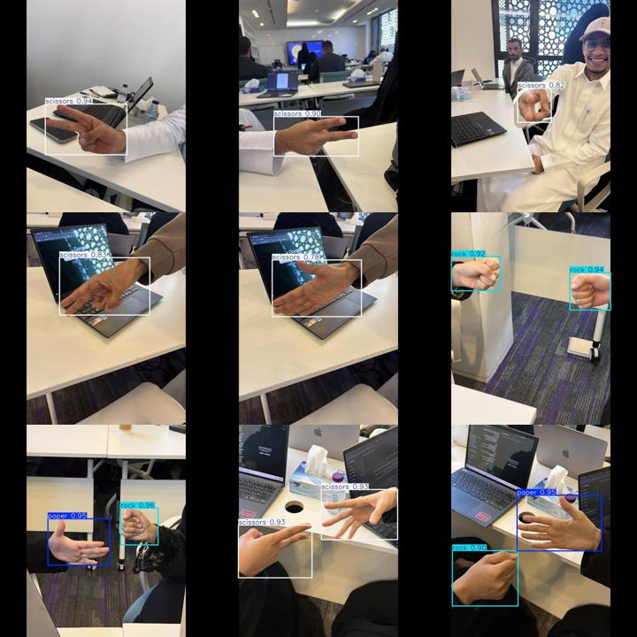
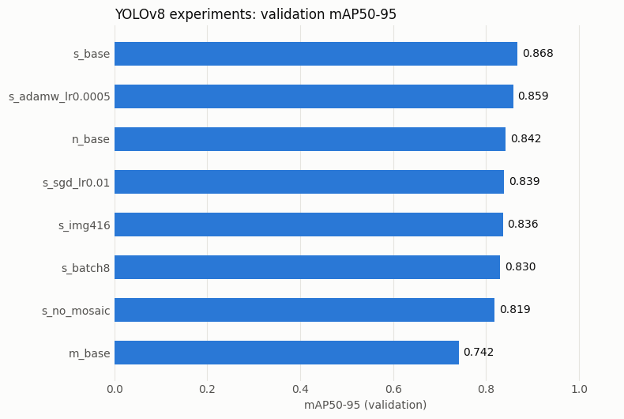
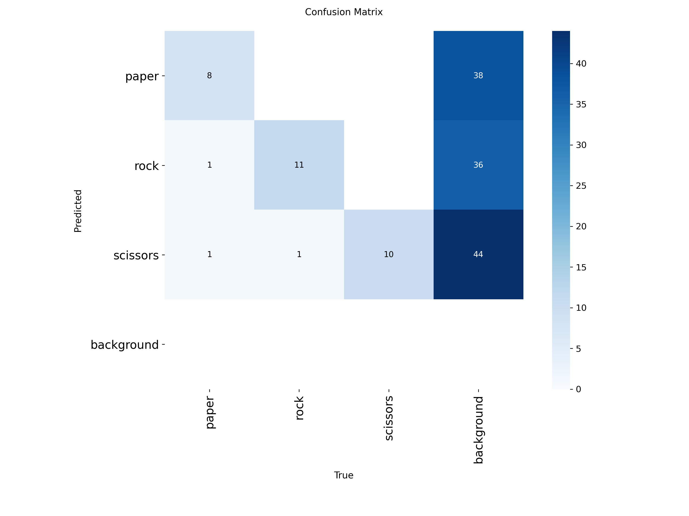
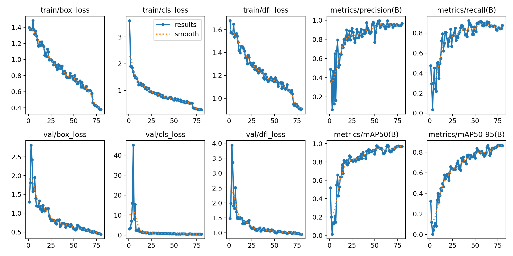

# Rock Paper Scissors Detector (YOLOv8)

An object detection model that finds hands in a photo and recognises the gesture: **rock**, **paper** or **scissors**. On top of the model we built a two-player game: the hand on the left is Player 1, the hand on the right is Player 2, and the app announces the winner.

The project follows the full object detection pipeline: collecting photos, annotating them in Roboflow, training YOLOv8 in Google Colab, comparing model sizes and hyperparameters, evaluating with mAP, precision and recall, and deploying the model in a Gradio web app.



## Repository contents

| File | What it is |
|---|---|
| `train.ipynb` | Colab notebook: downloads the dataset from Roboflow, trains 8 experiments, compares them |
| `app.py` | Gradio web app: the game on photos, webcam and video |
| `predict.py` | Command-line testing on new images |
| `rps.py` | Shared code used by both: loading the model and the game rules |
| `weights/best.pt` | The best trained model (`s_base`, YOLOv8s) |
| `assets/` | Charts and images used in this README |

## Dataset

| | |
|---|---|
| Classes | `paper`, `rock`, `scissors` |
| Original photos | 136, taken with our phone cameras |
| Split | 96 train / 27 validation / 13 test (70 / 20 / 10) |
| Photos with two hands | about 32 (the game needs two players in one photo) |
| Background photos | 11, with no label (hands typing, holding a phone or a bottle) |
| Instances | about 55 paper, 53 rock, 49 scissors (balanced) |

**Preprocessing (Roboflow):** resize to 640 x 640 with black edges (*Fit*), so tall phone photos keep their shape.

**Augmentation (training set only, 3 copies per photo, 288 training images):**

| Augmentation | Setting | Why |
|---|---|---|
| Flip | horizontal | hands come from both sides of the table |
| Crop | 0 to 25% zoom | hands at different sizes and positions, not always centred |
| Rotation | -15 to +15 degrees | nobody holds their hand perfectly straight |
| Brightness | -25 to +25% | room lighting differs from our photos |
| Exposure | -10 to +10% | different cameras |
| Blur | up to 1 px | laptop webcams are softer than phones |
| Motion blur | 10 px | hands move during the game |

We did not use hue (it changes skin colour), 90 degree rotation (sideways hands do not happen in the game) or cutout (it can hide the fingers that tell the gestures apart).

## Training

All experiments use the same dataset with `epochs=80`, `imgsz=640`, `batch=16` and `patience=20` (training stops early if validation stops improving). Each experiment changes **one thing only**, so any difference comes from that change.

| Experiment | Change | Val P | Val R | Val mAP50 | Val mAP50-95 | Test mAP50-95 | Size | Inference |
|---|---|---|---|---|---|---|---|---|
| **s_base** | YOLOv8s, default settings | 0.952 | 0.852 | **0.973** | **0.868** | 0.826 | 22.5 MB | 9.8 ms |
| s_adamw_lr0.0005 | AdamW, lr0 = 0.0005 | 0.931 | 0.882 | 0.951 | 0.859 | 0.888 | 22.5 MB | 9.7 ms |
| n_base | YOLOv8n (nano) | 0.901 | 0.909 | 0.946 | 0.842 | 0.896 | **6.5 MB** | **5.3 ms** |
| s_sgd_lr0.01 | SGD, lr0 = 0.01 | 0.945 | 0.935 | 0.970 | 0.839 | 0.783 | 22.5 MB | 10.0 ms |
| s_img416 | image size 416 | 0.948 | 0.832 | 0.946 | 0.836 | 0.901 | 22.5 MB | 6.0 ms |
| s_batch8 | batch size 8 | 0.984 | 0.879 | 0.943 | 0.830 | 0.837 | 22.5 MB | 9.8 ms |
| s_no_mosaic | mosaic off | 0.953 | 0.899 | 0.925 | 0.819 | 0.784 | 22.5 MB | 10.2 ms |
| m_base | YOLOv8m (medium) | 0.954 | 0.873 | 0.951 | 0.742 | 0.737 | 52.0 MB | 24.1 ms |

Inference time is per image on a Tesla T4 GPU in Colab.



### What the experiments showed

- **A bigger model is not better here.** YOLOv8m was the worst experiment in both dataset versions, and it is 2.5 times slower. With about 100 original photos it has far more parameters than the data can support, so it memorises the training images instead of learning the gestures.
- **YOLOv8n is a strong choice for speed.** It reached 0.842 mAP50-95, close to YOLOv8s, at less than a third of the size and about half the inference time.
- **Small differences are not reliable.** The validation set has 27 photos and the test set 13, so a few mAP points between experiments can be chance. Two signs of this:
  - In our first dataset version, SGD with lr0 = 0.01 was the best experiment. After adding more photos, it dropped to fourth place.
  - Validation and test often disagree: `s_base` is first on validation but fifth on test, while `s_img416` is fifth on validation and first on test.

We picked `s_base` because it is the best on the validation set, which is the set used to choose between models. The test set was kept for the final check only.

## Results of the best model (`s_base`)

### Per class (validation set)

| Class | Precision | Recall | mAP50 | mAP50-95 |
|---|---|---|---|---|
| paper | 0.964 | 0.800 | 0.977 | 0.812 |
| rock | 1.000 | 0.856 | 0.995 | 0.887 |
| scissors | 0.892 | 0.900 | 0.947 | 0.906 |



### Which gestures are detected well?

- **Rock** has the highest precision (1.00): on the validation set, every rock prediction was correct. A closed fist has a compact shape that nothing else in the photos looks like.
- **Scissors** has the best box accuracy (mAP50-95 0.906) and good recall (0.90). It was the weakest class in our first version and improved the most after we added photos.

### Which are missed?

- **Paper** has the lowest recall (0.80). On the test images, the model found every hand, but **two open hands seen from the side were predicted as scissors**. From the side, a flat hand shows a few extended fingers, which looks like the scissors gesture.
- In the game this matters: one of those test photos had scissors against paper, so the app would have called a draw instead of a win for Player 1.

### Training curves



Training and validation losses both go down until the end, so the model did not overfit. Validation mAP was still rising at epoch 80, so more epochs could help a little.

## What went wrong, and what we changed

We trained twice. The first version showed problems, and we fixed them with more data.

| | Version 2 (first) | Version 3 (final) |
|---|---|---|
| Original photos | 98 | 136 |
| Photos with two hands | 6 | about 32 |
| Background photos | 0 | 11 |
| Best val mAP50 | 0.919 | **0.973** |
| Best val mAP50-95 | 0.800 | **0.868** |
| Weakest class (recall) | scissors, 0.75 | paper, 0.80 |
| Test images with a hand not found (conf 0.5) | 2 of 9 | 0 of 9 |

1. **Almost every photo had one hand in the centre.** The model never learned two hands in one photo, which is exactly what the game needs. We added about 30 photos of two people playing, from the camera angle we play at.
2. **There were no background photos.** The model never saw hands that are not playing, so it drew boxes on things that were not gestures. We added 11 photos of hands typing, holding a phone and holding a bottle, with no label. We avoided relaxed hands that look like a fist or an open palm, because leaving those unlabelled would teach the model that a fist is sometimes not rock.
3. **The background column of the confusion matrix did not shrink.** It went from about 51 boxes to about 118, while the validation set also grew from 20 to 27 photos. We have not yet checked whether these are low-confidence boxes that the app's 0.5 threshold removes. On the test images shown above, at 0.5, no box appeared on the background.

## Limitations

- **Small evaluation sets.** 27 validation and 13 test photos are too few to rank experiments that are close to each other.
- **Photos from the same session.** Some validation and test photos were taken right after a training photo, in the same place with the same people, but with a different gesture. They are not duplicates, but the scores may be a little better than on a completely new room. That is why we also test on new photos with `predict.py` and live in the app.
- **Side views of paper.** The most common mistake. More photos of open hands from the side would be the most useful next step.

## How to run

Requires Python 3.10 or newer.

```bash
pip install -r requirements.txt
```

### Train (Google Colab)

1. Open `train.ipynb` in Colab and choose `Runtime > Change runtime type > T4 GPU`.
2. Run the cells in order. The notebook asks for your Roboflow API key when it runs; never write the key in the notebook.
3. Download `best.pt` at the end and put it in `weights/`.

### Test on new images

```bash
python predict.py my_photos/            # a folder, or a single image
python predict.py my_photos/ --conf 0.4 --out results/
```

For each image it prints the detected hands and the winner, saves an annotated copy, and writes everything to `results.csv`.

### Run the game

```bash
python app.py                # opens on http://localhost:7860
python app.py --share        # also creates a public link for other devices
```

In Colab, clone the repository and run `!python app.py --share`.

- **Play tab:** upload a photo or take one with the webcam. The app shows the boxes, labels the two players, and announces the winner.
- **Video tab (bonus):** upload a short video and get it back with the boxes and the result drawn on every frame. Only the first 30 seconds are processed.
- **Confidence slider:** raise it if the model draws boxes on things that are not hands, lower it if it misses a hand.

Put a few photos in an `examples/` folder and they appear under the Play tab as one-click examples.

**Game rule:** the two most confident hands are the players. The one further left in the image is Player 1.
